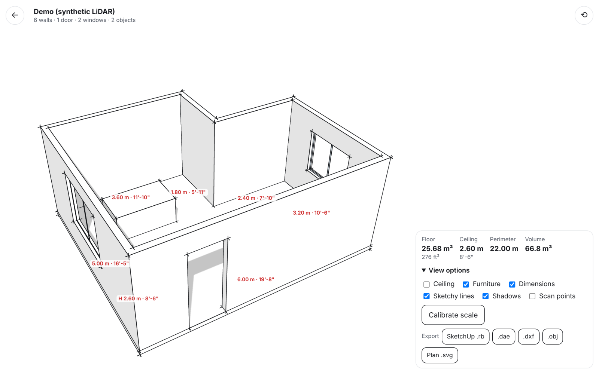

# RoomSketch (MVP)

Walk around a room with an iPhone and get a **measured, low-detail 3D model drawn as line work**: white
cel-shaded faces, black edges, gray shadows (SketchUp's default look). The model exports straight into
SketchUp.

This folder is self-contained and unrelated to anything else in the repo.



```
capture ──► point cloud ──► planes ──► room (outline, height, openings, furniture) ──► LOD model ──► toon viewer + exports
 LiDAR app export (metric)        RANSAC      wall-line arrangement + coverage           walls w/ thickness   .rb  .dae  .dxf  .obj  plan .svg
 or browser photos/video ─► COLMAP SfM + ArUco scale
```

## Why two capture paths

**iPhone Safari does not expose the LiDAR sensor to web pages.** WebXR depth sensing isn't available
on iOS, so no web app can read LiDAR directly today. RoomSketch therefore accepts two inputs into one
pipeline:

| Path | How | Scale | Accuracy (synthetic tests) |
|---|---|---|---|
| **LiDAR** (iPhone/iPad Pro) | Scan with a free LiDAR app (3D Scanner App, Polycam, Scaniverse), export PLY / OBJ / GLB, then open it in RoomSketch | metric from the sensor | outline and height within ~5 mm; openings within ~1 cm |
| **Photogrammetry** (any phone) | The browser camera auto-captures sharp, overlapping frames as you walk (or upload photos or a video). The server runs COLMAP structure-from-motion | printed **ArUco marker** of known size, auto-detected and triangulated | ~1% (≈4 cm over 5 m) with a 30 cm marker |

Without a marker, a photogrammetry result is provisionally scaled (it assumes a scene about 2.5 m tall) and flagged.
Tap **Calibrate scale**, then tap an edge you measured and type its real length. This works on any result.

## Running it

```bash
cd roomsketch
./run.sh            # http://localhost:8000 (desktop: demo room + uploads)
./run.sh --https    # https://<LAN-IP>:8443, self-signed, for camera capture from an iPhone on the same Wi-Fi
```

Mobile Safari only allows camera access over HTTPS. Alternatives to the self-signed cert:
`cloudflared tunnel --url http://localhost:8000` (gives a public https URL), or Docker:

```bash
docker build -t roomsketch . && docker run -p 8000:8000 -v roomsketch-data:/data roomsketch
```

### Hosted on Vercel

`vercel.json` deploys this folder as static files (`web/`) plus one Python function (`api/index.py`).
The room API is stateless: the browser parses the scan and thins it to 2.5 cm points before
uploading (a 200 MB export becomes a 2–4 MB request, inside the serverless body limit), then keeps the
solved room JSON in `localStorage` and posts it back for models and exports. Photogrammetry is turned off
there, because COLMAP and OpenCV don't fit a serverless bundle and a run takes minutes. Use the local or
Docker server for it.

Requirements are split: `requirements.txt` (core, all Vercel installs), `requirements-photogrammetry.txt`
(OpenCV + pycolmap), `requirements-dev.txt` (everything, plus test tools).

Tests: `pip install -r requirements-dev.txt && pytest`. The end-to-end photogrammetry test renders a
textured room with a marker and runs COLMAP (~4 min): `ROOMSKETCH_SLOW=1 pytest -k photogrammetry`.

## Using it

**LiDAR (best):** scan the room in your LiDAR app. Cover every wall from floor to ceiling, and the
ceiling itself. Export as PLY, OBJ or GLB, then choose **Import LiDAR scan**. The up axis is auto-detected; you can
override it under Options if the model comes out lying on its side.

**Camera capture:** print `marker.html` (the "Print the scale marker" link), measure the black square
and enter it under Options, then place it on the floor. Press the red button and walk slowly along the
walls with the phone upright, pointing across the room. Make a second pass tilted down at the floor and
one tilted up at the ceiling line. Finish where you started. 60–150 frames is typical. Textured rooms work best;
plain white walls are the classic weak spot of photogrammetry (use LiDAR there).

**Into SketchUp:**
- **SketchUp .rb** (best): Window › Ruby Console, then `load '/path/room-xxxx.rb'`. Creates real faces with
  holes, grouped and tagged per layer (walls, floor, ceiling, openings, furniture).
- **.dae**: File › Import (all versions). Tick "Merge coplanar faces".
- **.dxf**: SketchUp Pro / AutoCAD / Rhino. Line work on `*_LINES` layers plus 3D faces.
- **Plan .svg**: dimensioned floor plan (m and ft-in).

Exports follow the viewer's layer toggles (ceiling and furniture) and any scale calibration.

## How the geometry is solved (`app/pipeline/`)

1. **pointcloud.py**: load the scan (meshes are resampled evenly by area), rotate to Z-up, voxel-downsample to 2.5 cm, compute PCA normals.
2. **planes.py**: sequential normal-guided RANSAC. Each plane keeps only its largest connected patch.
3. **room.py**:
   - floor = lowest large horizontal plane; ceiling = highest one at least 1.8 m above it.
   - walls = tall vertical planes, snapped to the dominant (Manhattan) direction and merged.
   - The room outline comes from the **arrangement of infinite wall lines**: each 2D cell is kept if floor and ceiling points cover it. This handles L-shapes and other non-convex rooms, and tolerates gaps.
   - doors and windows = empty rectangles in each wall's 2D occupancy raster that have a wall frame around them and nothing occluding them from the room side. Their edges are then refined to the actual points.
   - furniture = 3D connected clusters of the leftover points, fitted with boxes squared to the room.
   - output is in a model frame: walls on the X/Y axes, floor at z = 0.
4. **lod.py**: wall solids with thickness, openings with reveals, floor and ceiling slabs, glazing panes and furniture blocks. Planar faces (with holes) plus the deduplicated crease edges.
5. **export.py**: SketchUp Ruby, Collada, DXF R12, OBJ, SVG plan.
6. **photogrammetry.py**: frame selection from video, COLMAP SIFT + matching + incremental SfM (CPU), gravity from camera "up" vectors, ArUco scale (rejects marker detections that do not triangulate to a square).

## Known limits / next steps

- **LiDAR inside the "web" flow:** the natural next step is a tiny native **App Clip** (opened from a URL or QR code, no install) that
  uses ARKit `sceneDepth`/RoomPlan, then uploads to this same backend. It is the only way to get LiDAR without a third-party app.
- Photogrammetry is sparse SfM only (dense MVS in COLMAP needs CUDA). A GPU worker running COLMAP/OpenMVS dense would
  greatly improve plain walls.
- One room per scan; walls must be planar (curved walls get faceted or dropped); sloped ceilings become flat.
- Openings are rectangles. Something hiding the wall that is not detected as an occluder can still read as a door.
- Furniture is LOD1 boxes: clutter that touches gets merged into one box.
- Photogrammetry jobs are processed one at a time and stored on disk under `data/`, with no authentication. It is a local prototype server.
- Saved rooms live in the browser that made them (`localStorage`); the scan-point overlay lasts only for the session that imported the scan.
